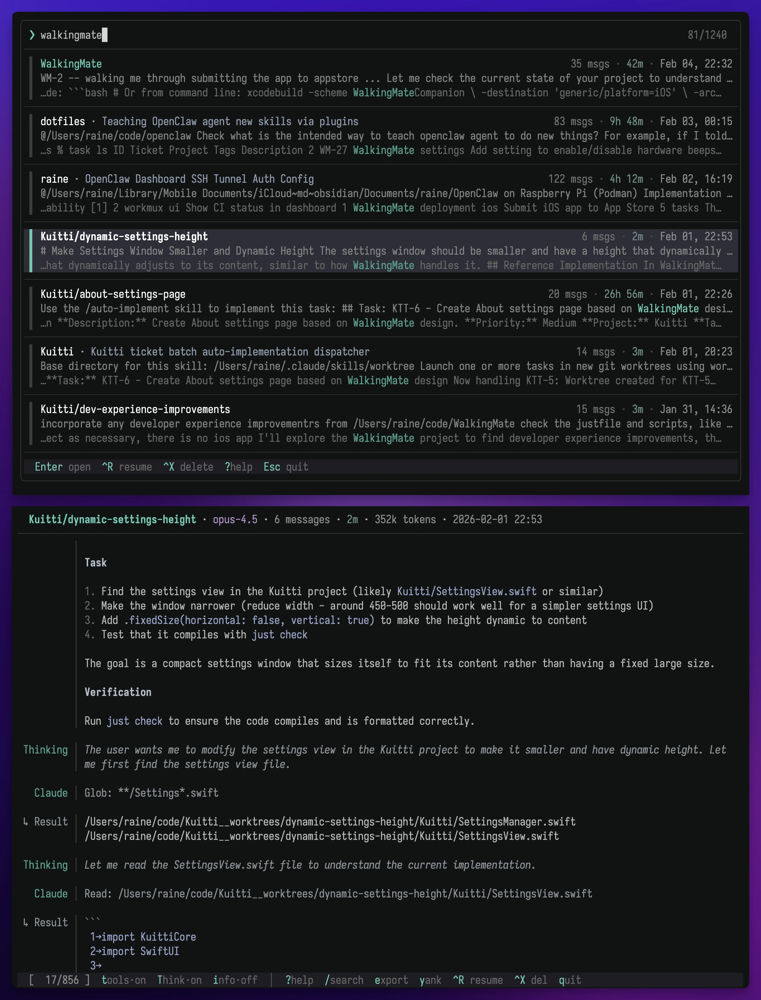
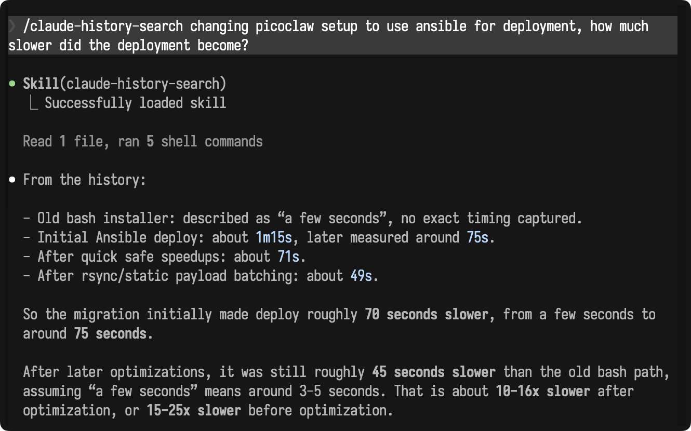

# pi-history

Fork of [brrock/pi-history](https://github.com/brrock/pi-history) with a fourth
tool display mode, **off**, which hides tool calls, results, and summaries.
Pi session names (`session_info`) are also shown in the session picker and searchable.

Fork-wide viewer defaults: **tools off · thinking off · diff show · info on · auto on**.
Sessions stay **oldest-first**, but open at the **latest message at the bottom**.
Auto-reload follows new messages until you scroll away. Press `g` to read from the top.
`diff show` is an action label: diff bodies stay hidden until you press `d`.
Explicit CLI flags and config settings override these defaults.

Press `t` to cycle modes, run `pi-history --tool-display off`, or set
`tool_display = "off"` under `[display]` in `~/.config/pi-history/config.toml`.

Build this fork from source (no fork release binaries are published yet):

```sh
cargo install --git https://github.com/csp256/pi-history --locked
```

> This is mostly based on the brillant, [claude-history](https://github.com/raine/claude-history), but modified to work with pi and other changes.



`pi-history` is a companion CLI for Pi coding agent. It lets you search recent
conversations recorded in Pi's local session history with a built-in
terminal UI, then view the selected transcript directly in the terminal with
scrolling, search, and export capabilities.

Run it from the project directory you work on with Pi coding agent and it will
discover the matching transcript folder automatically.

> [!TIP]
> **New:** Experimental semantic search is now available. See
> [Semantic search](#semantic-search) for details.
>
> **New:** Use the companion coding agent skill to let agents search your Pi
> history with the bounded `agent` command. See [Agent command](#agent-protocol)
> for the CLI workflow and skill path.

[Install](#install) · [Features](#features) · [Usage](#usage) ·
[Configuration](#configuration) · [Changelog](CHANGELOG.md)

## Features

- **Fuzzy search** across all conversations with field-aware relevance scoring,
  prefix matching, word boundary awareness, and tool output indexing
- **Conversation viewer** with vim-style scrolling, in-viewer search, message
  navigation, and markdown rendering
- **Resume and fork** conversations directly from the TUI with configurable
  keybindings
- **Cross-project fork** — fork a conversation from any project into your
  current working directory, useful when working across git worktrees
- **Worktree-aware** project filtering for
  [workmux](https://github.com/raine/workmux) users
- **Export and copy** conversations or individual messages to clipboard
- **Configurable** display options, keybindings, and default resume arguments

## Install

### Quick install

```sh
curl -fsSL https://raw.githubusercontent.com/csp256/pi-history/main/scripts/install.sh | bash
```


## Updating

```sh
pi-history update
```

## Usage

Run the tool from inside the project directory you're interested in:

```sh
$ pi-history
```

This opens a terminal UI listing all conversations, sorted by recency. Type to
search across all transcripts. Each item shows a preview of the conversation.
Quoted exact matches also show hidden context when the match is not visible in
the preview.

### Keyboard navigation (List mode)

| Key                     | Action                           |
| ----------------------- | -------------------------------- |
| `↑` / `↓`               | Move selection                   |
| `←` / `→`               | Move cursor in search            |
| `Ctrl+P` / `Ctrl+N`     | Move selection (vi-style)        |
| `Ctrl+D` / `Ctrl+U`     | Half page down/up (vim-style)    |
| `Page Up` / `Page Down` | Jump by page                     |
| `Home` / `End`          | Jump to first/last               |
| `Enter`                 | Open conversation viewer         |
| Mouse wheel             | Scroll the result list           |
| Mouse click             | Open conversation under cursor   |
| `Ctrl+O`                | Select and exit (for scripting)  |
| `Ctrl+W`                | Delete word before cursor        |
| `Ctrl+R`                | Resume conversation              |
| `Ctrl+F`                | Fork and resume conversation     |
| `F2`                    | Rename selected session          |
| `Ctrl+X`                | Delete conversation              |
| `Tab`                   | Toggle all / workspace scope     |
| `Ctrl+T`                | Toggle lexical / semantic search |
| `?`                     | Show keyboard shortcuts          |
| `Esc`                   | Clear search input, or quit      |
| `Ctrl+C`                | Quit                             |

### Keyboard navigation (Viewer mode)

| Key            | Action                                             |
| -------------- | -------------------------------------------------- |
| `j` / `↓`      | Scroll down                                        |
| `k` / `↑`      | Scroll up                                          |
| Mouse wheel    | Scroll the conversation                            |
| `J` / `]`      | Jump to next message                               |
| `K` / `[`      | Jump to previous message                           |
| `Ctrl+D`       | Half page down                                     |
| `d`            | Toggle edit diffs                                  |
| `u` / `Ctrl+U` | Half page up                                       |
| `Page Down`    | Full page down                                     |
| `Page Up`      | Full page up                                       |
| `g` / `Home`   | Jump to top                                        |
| `G` / `End`    | Jump to bottom                                     |
| `/`            | Start search                                       |
| `n`            | Next search match                                  |
| `N`            | Previous search match                              |
| `t`            | Cycle tools: summary/off/truncated/full            |
| `d`            | Toggle edit diffs                                  |
| `T`            | Toggle thinking                                    |
| `o`            | Toggle oldest-first / newest-first messages         |
| `a`            | Toggle auto-reload (once a second)                  |
| `r`            | Reload the open session from disk                  |
| `e`            | Export conversation to file                        |
| `y`            | Copy to clipboard (message if selected, else menu) |
| `p`            | Show file path                                     |
| `Y`            | Copy file path to clipboard                        |
| `I`            | Copy session ID to clipboard                       |
| `Ctrl+R`       | Resume conversation                                |
| `Ctrl+F`       | Fork and resume conversation                       |
| `Ctrl+X`       | Delete conversation                                |
| `?`            | Show keyboard shortcuts                            |
| `q` / `Esc`    | Return to list (or quit in direct file input mode) |
| `Ctrl+C`       | Quit                                               |

### Message navigation

Press `J`/`K` or `[`/`]` to enter message navigation mode. A teal `▌` marker
appears in the gutter showing which message is focused. While in this mode:

- `J` / `]` — jump to next message
- `K` / `[` — jump to previous message
- `y` — copy the focused message to clipboard (raw markdown)
- `Esc` — exit message navigation mode

Searching with `/` also activates message navigation, focusing the message
containing each match as you move through results with `n`/`N`. The status bar
shows the current match number and total matches while search is active.

### Search

Unquoted search matches words flexibly:

- `config` matches `CONFIG`
- `api key` matches `API_KEY`
- `auth` matches `authentication` and `authorize`
- `red` won't match inside `fired`
- multiple words must all match

Identifier-style terms with underscores keep the underscore, so `api_key` matches
`api_key` but not `api key`.

Use quotes when you need exact text. For example, `"DEPLOYMENT_TOKEN"` matches
`DEPLOYMENT_TOKEN` but not `deployment token`. Lowercase quoted text ignores
case, while quoted text with uppercase letters is case-sensitive.

You can mix both styles: `metrics "DEPLOYMENT_TOKEN"` searches for `metrics` as
usual, but only returns conversations that also contain `DEPLOYMENT_TOKEN`.

Search also includes tool results, not just user and assistant messages. Paste a
full session UUID to jump directly to that session. Quote the UUID to search for
it as transcript text instead.

Results are ranked by relevance using field-aware scoring: matches in the
title, project name, and summary are weighted higher than body text. Within
equally relevant results, recent conversations rank first.

### Semantic search

Semantic search ranks conversations by meaning instead of exact word matches. It
embeds recent conversation chunks locally, combines semantic similarity with
lexical signals, and shows the best matching evidence preview for each result.
The first semantic search may download the local model and generate embeddings,
which can take a while for large histories.

Quoted text works in semantic mode too. For example,
`deployment "DEPLOYMENT_TOKEN"` finds conversations where the matching visible
semantic evidence also contains the exact identifier. A quoted-only semantic
search, such as `"DEPLOYMENT_TOKEN"`, returns exact matches newest-first.

Press `Ctrl+T` in the conversation list to switch between lexical and semantic
search. To start in semantic mode by default, set:

```toml
[search]
mode = "semantic"
```

The older `[tui] semantic_search = true` setting is still accepted for existing
configs.

### Direct file input

You can open a JSONL conversation file directly, bypassing the conversation
selection UI:

```sh
$ pi-history /path/to/conversation.jsonl
```

All display options work in this mode:

```sh
$ pi-history --show-tools --show-thinking /path/to/conversation.jsonl
```

Press `q` or `Esc` to quit when viewing a file directly.

### Conversation viewer

Press `Enter` on a conversation to open the built-in viewer. The viewer displays
conversations in a ledger-style format with scrolling support.

**Features:**

- **Scrolling**: Navigate with vim-style keys (`j`/`k`), arrow keys, or the
  mouse wheel
- **Search**: Press `/` to search within the conversation, then `n`/`N` to
  navigate matches
- **Cycle tools**: Press `t` to cycle tool display (summary → off → truncated → full)
- **Toggle edit diffs**: Press `d` to show/hide full old/new edit diff bodies
- **Message order**: Press `o` to toggle oldest-first / newest-first (`order·old` /
  `order·new`). Only whole message blocks are reversed; text, code, and tool
  details inside each message keep their normal reading order. Toggling starts
  at the top of the selected order. Sessions initially open at the latest message
  (bottom for oldest-first, top for newest-first). Oldest-first remains the default; set
  `reverse_history = true` under `[display]` for newest-first on startup.
  Auto-reload follows the top in newest-first mode, unless you scroll away or
  are searching/navigating messages. Source files and full exports stay chronological.
- **Reload**: Press `r` to read new messages from disk while an agent is running.
  Reload preserves your reading position, display settings, and expanded outputs,
  and updates active search matches.
- **Auto-reload**: Press `a` to toggle polling for changes about once a second
  (`auto·on` / `auto·off` in the footer). It follows new messages if you are at the
  bottom, but preserves your position when reading earlier messages, navigating
  messages, or searching. It is on by default; set `auto_reload = false` under
  `[display]` to disable it on startup. Works in both picker and direct-file views.
- **Toggle thinking**: Press `T` to show/hide thinking blocks
- **Show path**: Press `p` to display the conversation file path
- **Light/dark theme**: Automatically detects terminal background color and
  applies an appropriate color theme

Press `q` or `Esc` to return to the conversation list.

### Agent protocol

Use `pi-history agent` when you want Pi coding agent to look up something from
your past Pi conversations. It gives agents a search-and-read workflow: find
the right conversation, narrow to the relevant section, then read only the few
messages needed as evidence.

The companion Pi coding agent skill at
[`skills/pi-history-search/SKILL.md`](skills/pi-history-search/SKILL.md)
tells agents how to use this workflow without pasting whole transcripts into
context.



An agent usually runs:

```sh
$ pi-history agent search --hybrid "deployment rollback decision" --top 5
$ pi-history agent within ch_1234abcd5678 --lexical "rollback"
$ pi-history agent read ch_1234abcd5678:m7..m9 --focus m8..m8
```

Agents should use semantic or hybrid search for remembered topics where the
exact wording is unknown, and lexical or exact search for identifiers,
filenames, commands, error messages, and stack traces.

Search is global by default. `--local` restricts search to the current
workspace. Results are grouped by conversation and include copyable
`read ref=... focus=...` lines for the next command. Reads are budgeted by
default so agents get the relevant excerpt instead of an entire transcript.

Useful options:

- `--top 10` controls how many conversations global search returns.
- `--hits-per-conv 2` controls how much evidence appears per conversation.
- `--tools`, `--tool-results`, and `--thinking` include content hidden from reads
  by default.
- `--no-budget` disables read truncation when you intentionally want unbounded
  output.

### CLI reference

```text
View Pi conversation history

Usage: pi-history [OPTIONS] [FILE]
       pi-history [COMMAND]

Commands:
  agent   Run agent-oriented search and transcript commands
  update  Update pi-history to the latest version

Arguments:
  [FILE]  JSONL conversation file to view directly

Options:
  -t, --show-tools       Show tool calls in the conversation output
      --no-tools         Show tool summaries in the TUI
      --tool-display MODE  Tool display: off, summary, truncated, full
  -d, --show-dir         Print the conversation directory path and exit
  -l, --last             Show the last messages in the TUI preview (default)
      --first            Show the first messages in the TUI preview
      --show-thinking    Show thinking blocks in the conversation output
      --hide-thinking    Hide thinking blocks from the conversation output
  -c, --resume           Resume the selected conversation in Pi coding agent
      --fork-session     Fork the session when resuming
  -p, --show-path        Print the selected conversation file path
  -i, --show-id          Print the selected conversation session ID
      --plain            Output plain text without ledger formatting
      --delete <SESSION_ID>  Delete a session by its UUID and exit
      --debug-search <QUERY>  Debug search result scoring for a query
      --debug [<LEVEL>]  Print debug information (optionally filter by level: debug, info, warn, error)
  -L, --local            Show only conversations from the current workspace directory
      --pager            Display output through a pager (less)
      --no-pager         Disable pager output
      --render <FILE>    Render a JSONL file in ledger format and exit
      --no-color         Disable colored output
  -h, --help             Print help
  -V, --version          Print version
```

### Preview modes

- `pi-history` shows the last messages in the preview (default)
- `pi-history --first` flips the preview to the first messages

### Showing tool calls

In the TUI viewer, tools default to **off**, hiding tool calls, results, and
summaries. Press `t` to cycle through modes: off → truncated → full → summary.
Truncated mode shows tool headers plus the first few body lines with a
"(N more lines...)" indicator. Click a truncated tool call/result to expand that
specific output, and click it again to collapse it. Use `--show-tools` (or `-t`)
to start in full mode, or `--no-tools` to start in summary mode.
Use `--tool-display off` to hide tools explicitly.

### Showing thinking blocks

Extended thinking models include reasoning steps in their output. Thinking is
hidden by default. Use `--show-thinking` (or press `T` in the TUI) to show
thinking blocks.

### Resuming conversations

If you want to continue a conversation, launch `pi-history` with `--resume`
and it will hand off to `pi --session <session-file>`.

To fork a conversation (creating a new session branching from the original), use
`--resume --fork-session` or press `Ctrl+F` in the TUI.

This passes `--fork <session-file>` to `pi`, which creates a new session branching from the original.

You can configure default arguments to pass to the `pi` command every time
you resume a conversation, such as `--offline` or a preferred `--model`.

If you use a shell alias for `pi` with extra flags, you can use `--show-id`
to select a session and resume it manually:

```sh
pi --session $(pi-history --show-id)
```

In the viewer, press `I` to copy the session ID to clipboard.

### Markdown rendering

Pi's responses are rendered with markdown formatting for better terminal
readability. Use `--plain` to disable rendering and get raw text output.

### Plain output mode

Use `--plain` to output conversations without ledger formatting:

```sh
$ pi-history --plain
```

This produces simple `Role: content` output without colors, text wrapping, or
markdown rendering, suitable for piping to other tools or LLMs:

```
You: How do I fix this bug?

Pi: Looking at the code, the issue is...
```

### Pager output

By default, conversation output is piped through a pager (`less -R`) when stdout
is a terminal. This enables scrolling through long conversations. Use
`--no-pager` to disable this behavior and print directly to stdout.

The pager respects the `$PAGER` environment variable. If not set, it defaults to
`less -R` (which preserves ANSI colors).

### Scope: all conversations vs current workspace

By default, `pi-history` shows all conversations from every project, sorted
by modification time (newest first). Each conversation shows its project path so
you can identify which project it belongs to.

Press `Tab` to toggle between all conversations and the current workspace only.
Use `-L`/`--local` to start with the workspace filter active.

For [workmux](https://github.com/raine/workmux) users, worktree paths are
displayed in a compact format: `[project/worktree]` instead of just the worktree
folder name. The project filter (toggled with `Tab`) is worktree-aware: it
includes conversations from the main repo and all its worktrees, regardless of
which one you're currently in.

The `--resume` flag works across projects. It will automatically run Pi in
the correct project directory for the selected conversation.

### Integration with other scripts

You can integrate `pi-history` into other tools to pass conversation context
to new Pi coding agent sessions. This is useful when you want Pi to understand
what you were working on previously.

For example, a commit message generator script could use the conversation
history to write more contextual commit messages:

```bash
# Get conversation history if --context flag is set
conversation_context=""
if [ "$include_history" = true ]; then
    echo "Loading conversation history..."
    conversation_history=$(pi-history --plain 2>/dev/null)
    if [ -n "$conversation_history" ]; then
        conversation_context="

=== START CONVERSATION CONTEXT ===
$conversation_history
=== END CONVERSATION CONTEXT ===

"
    fi
fi

# Pass to Pi CLI with the conversation context
prompt="Write a commit message for these changes.
${conversation_context}
Staged changes:
$staged_diff"

pi -p "$prompt"
```

## Configuration

You can set default preferences for display options in
`~/.config/pi-history/config.toml`. Command-line flags will override these
settings.

Create the config file:

```sh
mkdir -p ~/.config/pi-history
cat > ~/.config/pi-history/config.toml << 'EOF'
[display]
# Legacy tool display: true = summary, false = full (default: unset = off)
# no_tools = false
# tool_display = "off"  # off, summary, truncated, or full

# Show last messages in TUI preview (default: true)
# last = true

# Show thinking blocks (default: false)
show_thinking = false

# Show timestamps in the viewer (info toggle; default: true)
# show_info = true

# Display newest messages first (default: false; press o to toggle)
# reverse_history = true

# Auto-reload the open session once a second (default: true; press a to toggle)
# auto_reload = false

# Show old/new diffs in edit tool calls (default: false; press d in viewer)
edit_diffs = false

# Use plain output without ledger formatting (default: false)
plain = false

# Use pager for output (default: true when stdout is a terminal)
pager = true

[resume]
# Default arguments to pass to pi command when resuming
# Example: default_args = ["--offline"]

[keys]
# Customize keybindings (default: ctrl+r, ctrl+f, f2, ctrl+x)
# Supports ctrl+<key>, alt+<key>, single-character keys, and f1-f12
# rename = "alt+r"
# fork = "alt+f"

[search]
# Search mode: lexical, semantic, exact, or hybrid
mode = "lexical"

[tui]
# Hide exact project names from TUI browse/search lists
# exclude_projects = ["project-name", "repo/worktree"]

# Deprecated: use [search].mode instead
semantic_search = false

EOF
```

### Available options

#### Display options

- `tool_display` (string): `"off"`, `"summary"`, `"truncated"`, or `"full"`. Takes
  precedence over `no_tools`. Defaults to `"off"`, hiding all tool activity.
- `no_tools` (boolean): When `true`, shows tool summaries; when `false`, shows
  full tool details; when unset, defaults to off unless `tool_display` is set
- `last` (boolean): Show last messages instead of first in TUI preview (default:
  true)
- `show_thinking` (boolean): Show thinking blocks in conversation output
  (default: false)
- `show_info` (boolean): Show timestamps in the viewer (the `i` / info toggle; default: true).
- `reverse_history` (boolean): Display whole messages newest-first (default: false; press `o` to toggle).
- `auto_reload` (boolean): Poll the open session for changes once a second (default: true; press `a` to toggle).
- `edit_diffs` (boolean): Show old/new diffs in edit tool calls (default: false; press `d` in the viewer to toggle)
- `plain` (boolean): Output plain text without ledger formatting (default:
  false)
- `pager` (boolean): Pipe output through a pager for scrolling (default: true
  when stdout is a terminal)

#### Resume options

- `default_args` (array of strings): Arguments to pass to the `pi` command
  when resuming conversations. Example: `default_args = ["--offline", "--verbose"]`

#### Key bindings

Customize the keybindings for resume, fork, rename, and delete actions. Values
are key combinations like `"ctrl+r"`, `"alt+f"`, or `"f2"`.

- `resume` (string): Resume conversation (default: `"ctrl+r"`)
- `fork` (string): Fork and resume conversation (default: `"ctrl+f"`)
- `rename` (string): Rename selected session (default: `"f2"`)
- `delete` (string): Delete conversation (default: `"ctrl+x"`)

#### Search options

- `mode` (string): Search mode to use by default. Supported values are
  `lexical`, `semantic`, `exact`, and `hybrid` (default: `lexical`). The TUI
  supports lexical and semantic modes; exact and hybrid defaults start the TUI in
  lexical mode.

#### TUI options

- `exclude_projects` (array of strings): Case-sensitive project names to hide
  from TUI browse/search lists. Match against the project name shown in the
  leftmost column; a parent entry like `"repo"` also hides displayed worktree
  rows like `"repo/feature"`. Excluded conversations remain on disk and can
  still be opened by pasting their full UUID or by passing the JSONL file path
  directly.
- `semantic_search` (boolean): Deprecated compatibility alias. When
  `[search].mode` is unset, `true` starts list search in semantic mode and
  `false` starts lexical mode. Press `Ctrl+T` in the TUI to switch modes.

### Overriding config

Each display option has opposing flags for explicit override:

- `--tool-display off|summary|truncated|full` / `--no-tools` / `--show-tools`
- `--last` / `--first`
- `--hide-thinking` / `--show-thinking`
- `--plain` (no opposite flag)
- `--no-pager` / `--pager`

For example, if your config has `no_tools = false` (showing full tool details),
you can temporarily switch to summaries with `--no-tools`.

## Custom Pi config directory

If you use the `PI_CODING_AGENT_SESSION_DIR` environment variable to store Pi's
configuration in a non-default location, `pi-history` will respect it
automatically — no extra flags needed.

## Filtering details

The tool filters out some noisy artifacts before showing conversations, so you
only see transcripts that are likely to matter for your recent work.

- Skips the "Warmup / I'm Pi coding agent…" exchanges that are sometimes injected
  without user interaction
- Skips conversations that only contain the `/clear` terminal command

## Development

The repository includes `just` recipes:

```sh
$ just check
```

This runs `cargo fmt`, `cargo clippy --fix`, `cargo test`, and `cargo build`.
GitHub Actions also verifies the Nix build on pull requests, main, and release
tags.
